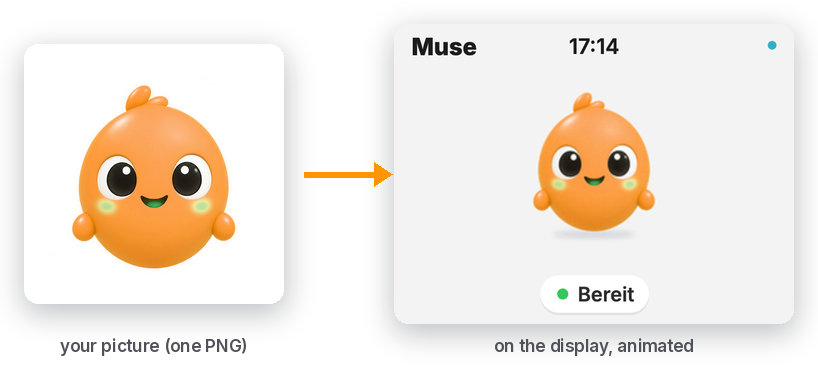

# Use your own character in 3 steps

<p align="center"></p>

The box and Muse Web Screen show the project's own figure by default. Any character can take its
place: a mascot, a drawing, a logo with eyes. What you need is one PNG of it, ideally with a
transparent background.

## 1. Make the frames

The display plays six files: `idle`, `wave`, `working`, `making` and `confetti` (animated PNGs)
and `avatar` (a still). `tools/make_figure.py --from-image` makes all six from one picture,
using the same motion as the project's figure: a bob and a breath, a sway, an orbiting spark,
twinkling sparkles, two hops with confetti.

From the project folder (Pillow and numpy come in through [uv](https://docs.astral.sh/uv/)):

```bash
# for the box (ESP32-S3-BOX-3): 160 x 160 frames, 72 x 72 avatar, files own_idle.png and so on
uv run --python 3.14 --with pillow --with numpy tools/make_figure.py --from-image my_character.png --prefix own_

# for Muse Web Screen: the web display looks for muse_<name>.png in its folder
uv run --python 3.14 --with pillow --with numpy tools/make_figure.py --from-image my_character.png --prefix muse_ --out web/local
```

| Option | Default | What it does |
|---|---|---|
| `--from-image PATH` | | the picture used for every pose |
| `--out DIR` | `firmware/figure` | where the six files go |
| `--prefix TEXT` | none | the start of every file name |
| `--size N` | `160` | the side of the animation frames; the square 480 x 480 layout ([SQUARE_LAYOUT.md](SQUARE_LAYOUT.md)) uses `280` |
| `--avatar N` | `72` | the side of the avatar; the square layout uses `84` |
| `--tolerance N` | `40` | how close to the border colour a pixel must be to count as background |
| `--sheet FILE` | | also writes every frame side by side, for a look before you flash |
| `--dry-run` | | lists what would be written |
| `--force` | | overwrites files that already exist (without it, `--from-image` never does) |

**No transparent background?** The tool takes the colour of the picture's border and cuts away
every pixel of that colour that is connected to the edge, so a white shirt on a white
background stays. A busy background does not work: cut it out first.

**Several poses instead of one picture.** `make_figure.py` without `--from-image` reads five
poses from `tools/figure_source/` (`neutral.png`, `blink.png`, `wave.png`, `working.png`,
`celebrate.png`, square PNGs with a transparent background) and registers each one on the
neutral pose before it animates them. This is how the project's figure is made. Put your own
five poses there (in a fork or a local copy; it replaces the project's) and run it with the
same `--out` and `--prefix`. `tools/make_figure_source.py` is how the project drew its poses
with an image model: every pose is an edit of `tools/figure_source/base.png`, and the prompts
(`LOOK` in the script) describe the project's character, so change both for yours.

## 2. Put them where the display finds them

**On the box.** With `--prefix own_` the files are `firmware/figure/own_idle.png` and so on;
`.gitignore` keeps them out of this repository. Tell the firmware to use them with the
substitution `figure_prefix`: in your overlay ([HOME_OVERLAY.md](HOME_OVERLAY.md))

```yaml
substitutions:
  figure_prefix: "own_"
```

or once on the command line: `esphome -s figure_prefix own_ run firmware/muse-esp32-s3-box-3-screen.yaml`.
Keep 160 and 72 for the BOX-3: its 320 x 240 layout is made for frames of that size. The six
files take the same flash as the project's figure (4,208,768 bytes as RGB565), because sizes and
frame counts are the same.

**In Muse Web Screen.** Run the page locally (`cd web && python3 -m http.server 8321`, then
http://localhost:8321/), open **Einstellungen**, set **Figur-Quelle** to *Eigene Bilder aus einem
Ordner* and **Ordner-URL der Bilder** to `http://localhost:8321/local`. The settings show how many
of the six pictures arrived. git and Vercel ignore `web/local/`, so your character stays on your
machine. On the hosted page, serve the folder instead with
`python3 web/tools/serve_frames.py --dir web/local` and use `http://127.0.0.1:8322` as the folder
URL (Chrome and Edge ask once for local network access). More on the web side:
[MAC_APP.md](MAC_APP.md) and [web/README.md](../web/README.md).

## 3. Flash or reload

- Box: `esphome run` as usual (over the air after the first flash). The ready screen shows your
  character; the other animations come with the status changes and with `muse_celebrate`.
- Web: reload the page.

## Whose picture is it?

Use a character you made or may use. Meta's Muse animations are Meta's artwork: they are never
part of this repository, a commit or a deployment ([README](../README.md#licence-and-third-party-work)).
`tools/check_private.py` refuses changed files under the project's own names
(`firmware/figure/idle.png` and so on), so keep yours under a prefix.
